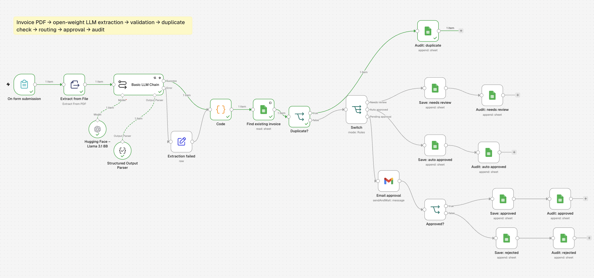

# AI invoice approval pipeline (n8n + Hugging Face)

An n8n workflow that turns invoice PDFs into approved, audited records. An open-weight LLM reads the invoice, and ordinary rules decide what happens next.



## How it works

```
Form upload (PDF)
  └─▶ Extract text from PDF
        └─▶ LLM extraction (Llama 3.1 8B via Hugging Face Inference Providers, structured output, 3 retries)
              ├─ success ───────────────────────────────┐
              └─ error ─▶ "Extraction failed" (empty) ──┤
                                                        ▼
                                              Validation (Code node)
                                                        ▼
                                  Duplicate check (Google Sheets, key = vendor + invoice no.)
                                    ├─ found ─▶ audit: DUPLICATE (stop)
                                    └─ new ─▶ Switch
                                               ├─ invalid ─────────▶ NEEDS_REVIEW
                                               ├─ total ≤ 20,000 ──▶ AUTO_APPROVED
                                               └─ total > 20,000 ──▶ email approval (wait)
                                                                        ├─ approve ─▶ APPROVED
                                                                        └─ reject ──▶ REJECTED
Every outcome is written to an `invoices` sheet and an append-only `audit` sheet.
```

## Design choices

- **The AI only extracts.** Validation, duplicate detection and routing are deterministic code, so the same invoice always gets the same decision.
- **Structured output.** The LLM must return a fixed JSON shape (vendor, invoice number, date, currency, subtotal, VAT, total).
- **Validation.** Missing vendor, invoice number or total, subtotal + VAT not equal to total, and future dates all fail validation.
- **Idempotency.** Each invoice gets a key (vendor + invoice number). A key already in the sheet is logged as `DUPLICATE` and not processed again.
- **AI failures never stop the workflow.** If the model returns nothing after 3 retries, the invoice continues as an empty extraction, fails validation and goes to human review.
- **Human in the loop.** Invoices above the threshold wait for an Approve/Disapprove decision by email.
- **Audit trail.** Every step that changes state writes a row: time, invoice key, event, detail.

## Test results

10 fictional invoices with a ground-truth file (`test_invoices/ground_truth.csv`), including one duplicate and one invoice with no amount.

| Result | Score |
|---|---|
| Field extraction (invoices with data) | All fields correct |
| Routing | 10 / 10 as expected (6 auto-approved, 1 approved, 1 rejected, 1 duplicate, 1 needs review) |

**What testing found:** on the invoice with no amount ("TBC"), the model returned an empty response and the first version of the workflow crashed. I added the error path and a clearer prompt, so the invoice now goes to human review instead.

## Known limits

- The approval threshold ignores currency (SAR and AED are compared as plain numbers).
- The duplicate key depends on the model writing the vendor name the same way each time; production would normalise it further or use a vendor ID.
- Money is stored as numbers in a spreadsheet; production would use a database with decimal types, a status column with allowed transitions, and optimistic locking.
- Test invoices are clean, generated PDFs; scanned or handwritten invoices would need OCR.

## Run it yourself

1. Import `workflow.json` into n8n (⋯ → Import from file).
2. Add your own credentials: a Hugging Face token (OpenAI-compatible credential, base URL `https://router.huggingface.co/v1`), Google Sheets and Gmail.
3. Create a Google Sheet with tabs `invoices` (invoice_key, vendor, invoice_number, invoice_date, currency, subtotal, vat, total, status, updated_at) and `audit` (time, invoice_key, event, detail).
4. Activate the workflow and upload the test invoices through the form.

All invoices in this repo are fictional test documents.
